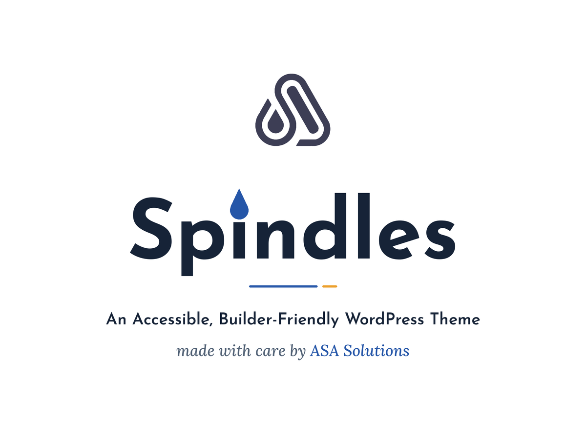

# Spindles

A minimalistic, accessible, builder-friendly WordPress theme by [ASA Solutions](https://asasolutionsltd.com/).

Spindles works fully on its own with no plugins required. It adds optional support for WooCommerce, Elementor Theme Builder, Advanced Custom Fields and Modern Events Calendar when those plugins are installed, and it works with page builders through two dedicated page templates.

## What is in this repository

| Folder | Description | Version |
|---|---|---|
| [`spindles/`](spindles/) | The parent theme | 2.1.1 |
| [`spindles-child/`](spindles-child/) | A child theme for safe customizations | 1.1.1 |

## Features

- Accessibility first: skip link, labelled landmarks, keyboard-operable menu, visible focus indicators and default colors that meet WCAG 2.1 AA contrast in light and dark modes.
- Design tokens in `theme.json`, light and dark color modes, accent and text color pickers, and adjustable content width.
- Header layouts (standard, centered, minimal), optional sticky header and header button, footer widget columns or compact footer, blog list or grid.
- Page templates: Full Width, Builder Neutral (keeps header and footer) and Builder Canvas (no header or footer).
- System fonts only, no third-party libraries, no external requests and no tracking.
- Translation ready (`spindles/languages/spindles.pot`).

## Requirements

- WordPress 6.6 or later (tested up to 7.1)
- PHP 7.4 or later

## Installation

1. Download or build `spindles.zip` from the `spindles/` folder (zip the folder itself so `spindles/style.css` is inside it).
2. In WordPress, go to Appearance > Themes > Add New Theme > Upload Theme and install it.
3. Optional: do the same for `spindles-child/` and activate the child theme.

See [`spindles/readme.txt`](spindles/readme.txt) for the full description, FAQ and changelog.

## Developer hooks

Actions: `spindles_before_header`, `spindles_after_header`, `spindles_before_content`, `spindles_after_content`, `spindles_before_footer`, `spindles_after_footer`.

Filters: `spindles_content_width`, `spindles_shop_products_per_page`.

## Quality checks

Before each release the theme is checked with PHP lint, the WordPress Coding Standards and WPThemeReview rulesets (PHP_CodeSniffer), PHP 7.4 to 8.4 compatibility, the Theme Check plugin, and axe-core accessibility tests against a WordPress install with and without WooCommerce.

## Contributing

Issues and pull requests are welcome. Please keep changes compatible with the WordPress.org theme review requirements: no plugin dependencies, escaped output, translatable strings with the `spindles` text domain, and readable (unminified) source.

## License

Spindles is released under the [GNU General Public License v2 or later](LICENSE). Credits for the screenshot typography and logo are listed in `spindles/readme.txt`.
